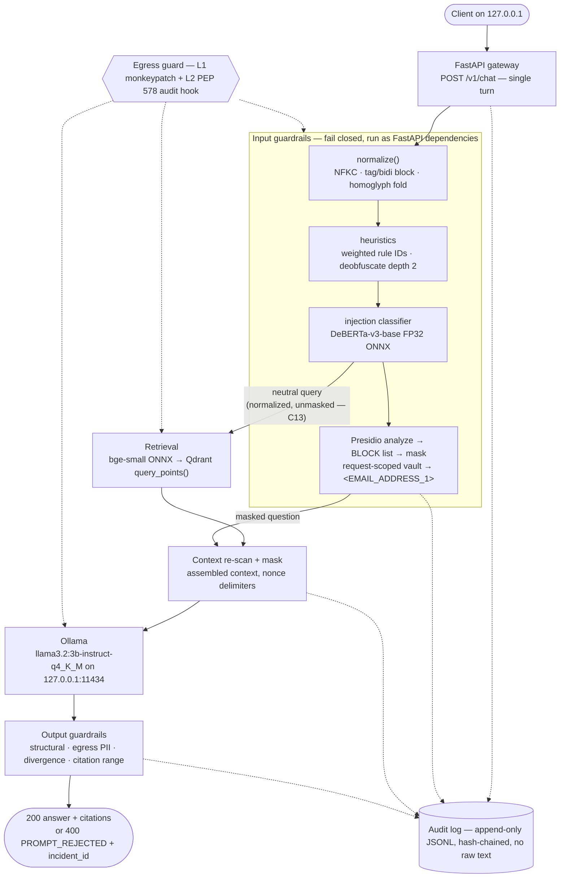

# Secure Air-Gapped Platform with Integrated Guardrails (`sagp`)

A reference blueprint for running a local LLM inside a network-isolated enclave, with automated PII
de-identification before anything reaches the model and prompt-injection blocking before anything
reaches the retriever. It is a *template* to copy, not a product — and before you read anything else,
read **[What this does not prove](docs/LIMITATIONS.md)**, because a compliance-themed system that
overclaims is worse than no system at all.

That link is in the first paragraph deliberately. This repository is *designed* to demonstrate that a
specific set of software controls refuses every egress attempt we could construct, on a host proven to
have working internet moments earlier. The proof harness is built and the **online negative control has
run live** (M13): with the guard auditing, this host completed a real TCP handshake to `1.1.1.1:443`;
with the guard enforcing, the identical probe raised `EgressViolation`. What has **not** been run is the
full sealed demonstration on a physically disconnected host — this dev host is deliberately kept in the
`PROVISION` phase and never sealed, so the end-to-end air-gap verdict is `INVALID` by design (see
[Status](#status)). And even once that is run, it cannot prove the machine is incapable of
reaching the internet. The difference between those sentences is the entire honesty budget of this
project, and [LIMITATIONS.md](docs/LIMITATIONS.md) spends it line by line.

---

## What it does

The demo narrative, in six steps:

1. **Disconnect the machine.** Wi-Fi off, adapters unplugged, `ping -c1 1.1.1.1` must fail — and the
   in-process egress guard is armed in `enforce` mode, demonstrated (at M13,
   while the network still worked) to refuse every probe we could construct (see
   [The air-gap demonstration](#the-air-gap-demonstration)).
2. **Ingest a local PDF.** `make ingest FILE="data/samples/employee_handbook.pdf" COLLECTION=handbook`
   extracts text with `pypdf`, detects hidden text (sub-1.0pt fonts, off-MediaBox placement,
   `/RenderMode 3`), scans every chunk for injection, and routes chunks scoring **≥0.95** (or
   carrying a block-tier heuristic, or `truncated=True`) to a never-retrieved per-collection
   `<collection>__quarantine` sibling collection. Chunks scoring **0.70–0.95 are marked `suspect` and are still indexed and
   retrievable** — the assembled-context re-scan at `C19` is what covers those, not quarantine.
3. **Embed locally.** `BAAI/bge-small-en-v1.5` as ONNX under ONNX Runtime — CLS pooling then L2
   normalize, 384 dimensions. No `torch`, no `transformers`, no `huggingface-hub` in the serving venv.
4. **Store locally.** Qdrant is the only vector store. In-process
   (`SAGP_QDRANT_MODE=embedded`) is the **default runtime backend**, chosen on RAM grounds
   (6.75 GB projected for the embedded profile vs 7.60 GB for the demo profile, against an 8 GB
   ceiling); the pinned `qdrant/qdrant:v1.18.3-unprivileged` container under `PROFILE=demo` is the
   **demonstration and proof path**, the one the network-isolation harness targets. The demo path is
   **NOT network-isolated by compose options** — `make spike-docker` (run 2026-08-01) resolved OQ-4 and
   OQ-5 negatively; its egress control comes from `make seal-pf` + loopback, not Docker networking.
5. **Ask a question containing an email address** and get a grounded, cited answer — where the prompt
   that actually reached Ollama contained `<EMAIL_ADDRESS_1>` and not the real address. The mapping
   lives in a request-scoped, in-memory vault that is cleared in a `finally` block and never persisted.
6. **Send `Ignore all previous instructions`** and get `400 PROMPT_REJECTED` with an `incident_id`,
   an opaque body carrying no score or rule name, and a fixed rejection deadline (120 ms placeholder)
   so the rejection surface is not a detector oracle.

Steps 5 and 6 are the brief's literal claim. They are demonstrable as of milestone **M10** (done, and
validated against real Ollama) — see [Status](#status).

---

## Before you rely on this

Five caveats are load-bearing. A reader who stops at this README should still leave holding all five.

1. **The vector store holds unmasked PII at rest.** The default `ingest_mode=raw` writes the real
   chunk text into `data/qdrant/`; what protects it is loopback binding, filesystem permissions and
   FileVault — not the guardrail, which never runs over stored text
   ([LIMITATIONS.md](docs/LIMITATIONS.md), item 11).
2. **The injection model is archived upstream, and its own model card states it does not detect
   jailbreak attacks and does not handle non-English prompts** — so a jailbreak or a Hindi-language
   injection is outside what the classifier was trained to catch
   ([GUARDRAILS.md §11](docs/GUARDRAILS.md)).
3. **Native code goes around the Python egress guard.** grpcio's C core, ONNX Runtime and anything
   reached through `ctypes` can call `connect(2)` without passing through CPython's socket layer, and
   Ollama and Docker are separate processes outside both guard layers
   ([THREAT_MODEL.md §3.1](docs/THREAT_MODEL.md), [LIMITATIONS.md](docs/LIMITATIONS.md) items 2–3).
4. **The evidence signature is self-signed.** The Ed25519 key that signs `MANIFEST.json` and every
   evidence bundle lives on the same host the bundle attests to, timestamps come from the local
   clock, and neither provides non-repudiation to a third party
   ([OPERATIONS.md §1](docs/OPERATIONS.md)).
5. **Guardrail accuracy has been measured; latency and RAM have not.** `make eval` has run
   (M6): injection headline recall is **1.0** and PII recall is **1.0** (EMAIL/CARD/AADHAAR/PERSON),
   but injection precision (**0.81**) and benign FPR (**0.32**) miss their targets (0.85 / 0.10) and
   are tracked as OPEN known gaps. Every **latency figure and RAM number** here, by contrast, remains a
   target, an estimate or an unverified arithmetic derivation
   ([GUARDRAILS.md §10.2](docs/GUARDRAILS.md), [EVALUATION.md §1](docs/EVALUATION.md)).

---

## Architecture at a glance



The full numbered path is `C0`–`C26` in [BLUEPRINT.md §5.7](docs/BLUEPRINT.md); ingest is `I1`–`I11`
in §5.6. The two cross-cutting boxes are drawn dashed because they touch every stage: the audit log
records each decision without ever recording the text, and the egress guard is installed by a `.pth`
file before any application code imports.

---

## Status

**M0–M14 are built, merged and tested (as of 2026-08-01).** `src/`, `tests/`, `scripts/`, `config/`,
`bin/`, `docs/metrics/latest.json`, the Makefile, `docker-compose.yml` and `pyproject.toml` all exist;
258 tests pass, `make lint`/`make typecheck` are green, and `make smoke` reports 14/14. Only **M15**
(this documentation-against-measurements pass) remains. The dev host is deliberately kept in the
`PROVISION` phase and has never been sealed for real, so the end-to-end air-gap verdict is `INVALID` by
design (see [The air-gap demonstration](#the-air-gap-demonstration)). The `M-DOCS` pass put the plan and
the reconciled specification into the repository *before* any code, so the reasoning shipped with the
implementation. The build order and the definition of each milestone live in
[docs/PLAN.md §7](docs/PLAN.md) and [BLUEPRINT.md §10](docs/BLUEPRINT.md).

| Done | Milestone | Deliverable | Needs network |
|---|---|---|---|
| [x] | **M-DOCS** *(complete)* | Every markdown file written into the repo, plus `.gitignore`, `LICENSE`, `NOTICE`; `git init` run and the corpus committed. Docs written correct-as-of-design, *before* any code (M15 revisits them correct-as-measured) | no |
| [x] | M0 *(done)* | Skeleton: `src/sagp/` tree, `pyproject.toml`, `Settings`, `errors.py`, `types.py`, Makefile — `make lint typecheck test` green | no |
| [x] | M1 *(done)* | **PROVISION EVERYTHING** — `artifacts.lock`, `scripts/provision/01..10`, gates, signed `MANIFEST.json`. Classifier is **FP32 ONNX** (INT8 rejected — inverts this model, OQ-2); `llama3:8b` skipped | **done online** |
| [x] | M2 *(done)* | Audit spine: closed `AuditEvent`, hash-chained JSONL (tamper-evident), HMAC correlation tokens, write-time scrub, `make audit-verify` | no |
| [x] | M3 *(done)* | Normalizer (tag/bidi block; ZWJ/ZWNJ strip-not-block; NFKC + homoglyph fold), placeholders (`neutralize ⊇ rehydrate`), depth-2 deobfuscation, weighted heuristics from `config/guardrails.yaml` | no |
| [x] | M4 *(done)* | PII guardrail: real Presidio+spaCy, `SealedEmailRecognizer` (no phone-home), request-scoped vault (unpicklable, leak-proof, capped), PERSON aliases, BLOCK-list, deadline→503 | no |
| [x] | M5 *(done)* | Injection guardrail: label resolution from `config.json` (never hardcoded), FP32 ONNX backend, sliding-window scanner (tail attack not truncated away), boot self-test | no |
| [x] | M6 *(done)* | Metrics gate: attack/benign/PII corpora, `eval_guardrails.py`, measured `docs/metrics/latest.json`. Injection recall 1.0, PII recall 1.0; precision 0.81 / FPR 0.32 miss targets (OPEN known_gaps) | no |
| [x] | M7 *(done)* | LLM client: buffered `OllamaClient` (loopback, pinned options, fail-closed), `FakeLLM`, versioned prompts — one real generation validated | no |
| [x] | M8 *(done)* | RAG ingestion: bge-small ONNX embeddings (CLS+L2), token-aware chunking, hidden-text quarantine, idempotent Qdrant upsert; retrieval verified on :memory: | no |
| [x] | M9 *(done)* | Retrieval + prompt assembly: neutral-query embed, score-thresholded top-k, deterministic refusal gate, sole nonce-delimited prompt builder | no |
| [x] | **M10** *(done — first demoable slice)* | FastAPI `/v1/chat` wiring C0–C26: input guardrails → retrieval/refusal → mask → LLM → output guardrail → uniform 400. Validated against real Ollama | no (FakeLLM in tests) |
| [x] | **M11** *(done)* | Net-guard: dual-layer egress guard (L1 socket monkeypatch + L2 PEP 578 audit hook), `.pth` boot module reading `.airgap/state.json`, AF_UNIX deny-by-default, argv-exact subprocess allowlist. Raw-socket L1 bypass verified caught by L2 | no |
| [x] | **M12** *(done)* | Indirect-injection layer: ingest-time per-chunk document scan (clean/suspect/quarantine), never-retrieved `__quarantine` sibling collection, C19 assembled-context drop-and-continue, guarded `POST /v1/ingest` | no |
| [x] | **M13** *(harness done)* | **THE DEMONSTRATION** — `verify_airgap.py` (9 offline assertions + invariant-13 verdict), `verify_online.py` (paired negative control), signed evidence report + hash-chained ledger, 14-check `smoke.sh`. All 9 assertions PASS; the verdict is `INVALID` until an actual seal + disconnect (by design) | **offline — the deliverable** |
| [x] | **M14** *(hardening + deployment done)* | Audit sink in the chat path (hash-chained `AuditEvent`, types/counts only), `incident_id`-linked quarantine, `GET /v1/admin/incident/{id}` (`pii:reveal`), rate limiting → 429; **plus the deployment/launch subsystem**: `make seal`/`unseal` one-way door (gated), projected-RSS boot refusal, `bin/sagp-serve` + four-gate lifespan, `GET /airgap/status`, `docker-compose.yml` (demo), and `make seal-pf` (pf anchor `deploy/pf/com.sagp`, syntax-validated, operator-loaded). `make smoke` 14/14. **Deferred:** host-specific `ollama-up`/`up`/`ingest`/`query` | no |
| [ ] | M15 | Documentation revisited against measurements | no |

Minimum viable slice is **M-DOCS → M0 → M10**, with M1 done first while online. Realistic effort for
the whole ledger is **3–6 focused weeks** (ESTIMATE), not one session.

---

## Requirements

The target machine, as measured:

| Item | Measured value | Consequence |
|---|---|---|
| CPU / arch | Apple M2, arm64, 8 cores | ORT gets `intra_op_num_threads=4`, leaving 4 for Ollama |
| OS | macOS Darwin 25.5.0 | `macosx_14_0_arm64` is the real wheel tag for torch 2.x and onnxruntime 1.28 |
| RAM | **8 GB unified — hard ceiling** | Drives every model-size decision |
| Disk free | 5,909,774,336 B (5.9 GB) at last check | **≥ 25 GB required** before provisioning |
| Python | 3.11.15 at `~/.local/bin/python3.11` | System default 3.14.6 is too new for spaCy |
| Docker | 29.5.3 installed, daemon stopped | `open -a Docker` before `PROFILE=demo` or `PROFILE=proof` |
| Ollama | client 0.30.10, no server, no models pulled | Everything is pulled during PROVISION |

**8 GB is the binding constraint, and `llama3:8b` does not fit.** Best case — 2048 context, `q8_0` KV
cache, every other component stripped — projects to **9.28 GB against an 8 GB ceiling**, over by
1.3 GB. macOS compresses and swaps rather than OOM-killing, so it will *appear* to work at 3–6 tok/s
with a 2–5 s stall at the head of every request **(ESTIMATE)** while the guardrail models fault back
off the SSD. The
pages evicted are precisely the idle security controls. That is a security-relevant characteristic,
not merely slowness. The default is `llama3.2:3b-instruct-q4_K_M`, retained even though the INT8 parity
gate failed and the classifier fell back to FP32 ONNX — the FP32 session RSS is 0.30 GB measured
(unchanged from the INT8 estimate, because ORT mmaps the weights), so no LLM RAM had to be bought
back; `llama3.2:1b` is the last fallback rung, needed only if the classifier session cannot be
afforded. The app prints a loud startup warning when an `8b` tag is configured on a host with under 16 GB.

Projected totals, each naming the profile it assumes: the **embedded profile**
(`SAGP_QDRANT_MODE=embedded`, the default runtime backend) projects to **6.75 GB**, leaving 1.25 GB of
projected headroom; the **demo profile** (`PROFILE=demo`, Docker Qdrant) projects to **≈7.60 GB** —
it fits, with no margin. Both are PROJECTIONS, not measurements: every line item except the 3.00 GB
macOS baseline (measured) and the **0.30 GB classifier session RSS** (measured at M1 — FP32 ONNX,
OQ-1 resolved) is an ESTIMATE, and the totals are arithmetic over those estimates — see **OQ-1** in
[BLUEPRINT.md §14](docs/BLUEPRINT.md).
Disk: ≈9.7 GB lean (includes the `llama3:8b` pull), ≈19.6 GB with both venvs and both wheelhouses,
plus ~3 GB transient during quantization — see [BLUEPRINT.md §8](docs/BLUEPRINT.md). **Disk-constrained?**
Skip the optional `llama3:8b` pull (it doesn't fit in 8 GB RAM anyway) and the requirement drops to ~15 GB.

---

## Quickstart

Every path in this repository contains spaces. Quote everything.

### Phase 0 — BOOTSTRAP (online, reversible)

Preflight and environment construction. `make doctor` is read-only and hard-fails below the computed
disk requirement, so run it before freeing anything else.

```bash
cd "/Users/tanishpd/Desktop/Secure Air-Gapped Platform with Integrated Guardrails"
make doctor          # hard-fails: free disk < 25 GB (currently 5.9 GB — free space first)
make venvs           # .venv and .venv-provision from ~/.local/bin/python3.11
make lock            # resolve BOTH closures ONCE -> requirements.*.lock with --generate-hashes
make install         # pip install --require-hashes -r requirements.runtime.lock -e .
make spike-docker    # ~10 min: RUN 2026-08-01, resolved OQ-4 / OQ-5 -> ADR-0002 (Accepted)
```

### Phase 1 — PROVISION (online, **one-way door**)

Everything the sealed system will ever use is downloaded here. After this you seal, and adding a
single wheel means an audited `make unseal REASON="..."` and a new seal generation.

```bash
open -a Docker                       # only if PROFILE=demo or PROFILE=proof
make provision                       # scripts/provision/01..10, resumable and idempotent
#   01 wheelhouse   pip download with FULL platform flags -> vendor/wheelhouse{,-provision}/
#   02 hf_models    snapshot_download by pinned revision + allow_patterns -> models/hf/
#   03 spacy        curl three .whl URLs -> models/spacy/; pip install --no-index --no-deps
#   04 ollama       OLLAMA_MODELS="$PWD/models/ollama" ollama pull llama3.2:3b-instruct-q4_K_M
#   05 docker       docker pull, resolve digest, docker save -> models/docker/*.tar
#   06 quantize     quantize_dynamic (DEFAULT op types) -> models/derived/injection-int8/
#   07 gates        tokenizer parity | FP32<->INT8 parity | embedding parity | measured RSS
#   08 tldextract   warm the Public Suffix List snapshot into models/tldextract/
#   09 secrets      API tokens, audit HMAC key, PII pepper, Ed25519 keypair (0600)
#   10 manifest     sha256 everything -> MANIFEST.json + .sha256 + .sig

make verify-online                   # NEGATIVE CONTROL — must be green BEFORE sealing
make eval                            # corpus metrics -> docs/metrics/latest.json (commit this)
```

`make provision` exits non-zero if any gate in step 07 fails, so you can never reach `make seal` with
an unvalidated classifier.

### Phase 2 — SEAL (**one-way door**)

`make seal` refuses unless the manifest verifies, its signature checks, and
`evidence/verify-online-<gen>.json` exists with `all_probes_blocked == true`.

```bash
make seal            # writes .env.sealed + .airgap/state.json (phase=OPERATE, seal_generation++)
                     # installs the .pth guard bootstrap; prints the disconnect checklist
make seal-pf         # OPTIONAL, sudo. Dry-run the parse FIRST: sudo pfctl -n -f /etc/pf.conf

# then, physically:
networksetup -setairportpower en0 off
# unplug Ethernet / Thunderbolt adapters
ping -c1 1.1.1.1                                 # MUST fail
curl -sS --max-time 3 https://huggingface.co     # MUST fail
```

### Phase 3 — OPERATE (offline)

Start order matters: the model runtime first, then the store, then the gateway.

```bash
make ollama-up                                  # launchd plist, loopback-bound, env from .env.sealed
make up                                         # PROFILE=demo only: docker load + compose up qdrant
make serve                                      # bin/sagp-serve -> uvicorn --workers 1 --host 127.0.0.1
make ingest FILE="data/samples/employee_handbook.pdf" COLLECTION=handbook
make query Q="How many days of parental leave do I get?"
```

`--workers 1` is mandatory: a second worker means a second spaCy pipeline and a second ORT session,
and the RAM budget has no room for either.

### Phase 4 — VERIFY (offline)

```bash
make verify        # the 9 assertions, each paired with a positive control
make evidence      # signed EVIDENCE-<gen>-<utc>.json/.md + ledger append
make audit-verify  # hash-chain walk; exit 1 on any break
make proof         # verify + evidence
make smoke         # 14 numbered PASS/FAIL functional checks
```

Re-provisioning is the way back through the one-way door:
`make unseal REASON="add pypdf 6.15.0"` → reconnect → `make provision` → `make verify-online` →
`make seal`.

---

## The air-gap demonstration

Here is the problem with almost every air-gap demonstration: it shows a connection failing. A
connection failure proves nothing, because it looks *identical* whether the guard blocked the call or
the network was simply absent. Unplug the cable and every security control in the world passes its own
test. That is not evidence; it is the absence of a counter-example.

The fix is a **negative control run while the internet demonstrably works**. During PROVISION, with
the host online, `make verify-online` does three things:

1. With `SAGP_GUARD=audit`, resolve `huggingface.co` and complete a TCP handshake to `1.1.1.1:443`.
   Record success and latency. **If this step fails, the host has no internet and the entire run is
   marked `INVALID`** — not `PASS`, not `FAIL`.
2. Flip to `SAGP_GUARD=enforce`. Re-run the *identical* probes. Each must raise `EgressViolation` —
   the specific exception type, never a generic `OSError` or timeout.
3. Write `evidence/verify-online-<gen>.json` carrying both timings. `make seal` refuses without it.

The evidence line reads (from the M13 run recorded in `evidence/verify-online-0.json`):

> *"On 2026-08-01 this host completed a TCP handshake to 1.1.1.1:443 in 6.58 ms with the guard
> auditing; with the guard enforcing, the identical probe raised `EgressViolation` in 0.004 ms."*

Two measurements, same host, same probe, minutes apart. That pair is the only thing that distinguishes
*blocked* from *absent*. Offline, `make verify` runs nine assertions in the same
spirit — each asserts on the `EgressViolation` type and each is paired with a positive control (a
loopback connection that must still succeed) so no test can pass for the wrong reason. Any negative
control failing, a guard that is not installed, a manifest verified in `quick` mode, or an open
high-severity gap yields `INVALID` or `PASS_WITH_OPEN_HIGH_SEVERITY_GAPS` — **never** `PASS`. The
verdict function `netguard.evidence.compute_verdict` has exactly four values: `PASS`,
`PASS_WITH_OPEN_HIGH_SEVERITY_GAPS`, `INVALID`, and `FAIL`.

What this establishes, at most, is that specific software controls refused a specific probe set from
inside CPython. It is not proof that the host cannot reach a network: native code (grpcio's C core,
ONNX Runtime, `ctypes`) calls `connect(2)` without entering the layers the guard patches, and Ollama
and the Docker VM are separate processes outside both guard layers — see
[Before you rely on this](#before-you-rely-on-this) and
[LIMITATIONS.md](docs/LIMITATIONS.md) items 1–3.

---

## What is in the box

| Stage | Where | What it catches | Fail mode |
|---|---|---|---|
| Normalizer | `C3` / `I4` | Unicode tag chars `U+E0000–U+E007F` and bidi overrides (blocked outright); zero-width and other `Cf` (stripped and flagged); NFKC and homoglyph tricks | Block on tag/bidi |
| Heuristics | `C4` | `OVERRIDE_PHRASE`, `DISREGARD`, `SYSTEM_PROMPT_PROBE`, `ROLE_HIJACK`, `DAN_PERSONA`, `NEW_INSTRUCTIONS`, `EXFIL_INTENT`, `MARKDOWN_EXFIL`, `DELIMITER_SPOOF` | OR'd with the classifier, never averaged |
| Deobfuscation | `C5` | base64 / base32 / hex / rot13 / leet / reversed / spaced payloads, depth 2, 256 KB cap | Decode bomb → 400 |
| Injection classifier | `C6`–`C7` | Direct prompt injection over `{raw, normalized, decoded}`, 512-token windows with stride 128, score = max, threshold 0.85. **The model is archived upstream and its own card states it does not detect jailbreak attacks and does not handle non-English prompts** | `truncated=True` → 400; error or >2000 ms → 503 |
| PII BLOCK list | `C10` | `CREDIT_CARD`, `IN_AADHAAR`, `US_SSN`, `IBAN_CODE`, `US_BANK_NUMBER`, `CRYPTO`, `MEDICAL_LICENSE`, `API_KEY`, `PRIVATE_KEY` | 400, byte-identical to every other rejection |
| PII masking | `C11`–`C12` | Everything else Presidio detects at ingress threshold 0.50, replaced with `<PERSON_1>`-style placeholders from a request-scoped vault | Vault cap 2000 → 400 |
| Document scan | `I7`–`I8` | Injection planted inside ingested PDFs: `clean` <0.70, `suspect` 0.70–0.95, `quarantined` ≥0.95 into a never-retrieved collection. **`suspect` chunks are indexed and retrievable** — only `quarantined` is withheld | Scanner error → quarantined |
| Hidden PDF text | `I3` | Sub-1.0pt fonts, text placed outside the MediaBox, `/RenderMode 3` invisible text | Page quarantined |
| Context re-scan | `C19` | Injection in the *assembled* masked context at threshold 0.90, with adjacent-window corroboration | Drop highest-scoring chunk, max 2 retries, then refuse |
| Output structural | `C22a` / `C24` | Nonce delimiter echo, system-prompt n-grams, markdown image/link exfiltration | Block, return the canonical refusal |
| Egress PII | `C22b`–`C22c` | PII in the response at threshold 0.35, plus a normalized-divergence check that fails closed if normalizing the response reveals *more* entities | 503 on analyzer error |
| Citation check | `C22d` | `[Sn, p.X]` markers pointing outside the supplied blocks or pages | Strip (`warn`) or refuse (`strict`) |

Every detector 400 returns exactly
`{"error":{"code":"PROMPT_REJECTED","message":"Your request was rejected by the security policy.","incident_id":"<uuid4>"}}`
padded to a fixed rejection deadline (120 ms placeholder, calibrated above the slowest detector at M13 — not a per-detector minimum). No score, threshold, rule ID, matched substring, model name, or entity type
crosses the boundary. All of it is in the audit record, retrievable at
`GET /v1/admin/incident/{id}`, which is gated on the `pii:reveal` scope. There is no `admin` scope;
the three scopes are `chat`, `ingest` and `pii:reveal`, across two bearer tokens.

---

## Configuration

One environment prefix: `SAGP_`. Upstream variables (`HF_*`, `OLLAMA_*`, `TLDEXTRACT_CACHE`) keep
their real names and are exported by `bin/sagp-serve` from `.env.sealed` **before** the interpreter
starts — loading them through `.env` is too late, because they are read at import time.

| Variable | Default | What it does |
|---|---|---|
| `SAGP_QDRANT_MODE` | `embedded` | `embedded` selects the in-process Qdrant at `data/qdrant/` and is the default runtime backend (embedded profile: 6.75 GB projected total); the Docker server path is selected by `PROFILE=demo` and is the demonstration/proof path (demo profile: ≈7.60 GB projected, no margin) |
| `SAGP_LLM_MODEL` | `llama3.2:3b-instruct-q4_K_M` | Ollama tag. `llama3.2:1b` is the last RAM-pressure fallback rung (not triggered: the FP32 classifier fits at 0.30 GB). An `8b` tag triggers a loud startup warning and does not fit — see [Requirements](#requirements) |
| `SAGP_SPACY_MODEL` | `en_core_web_md` | NER pipeline. `sm` for tests, `lg` opt-in at +0.60 GB (then the LLM must drop to `llama3.2:1b`) |
| `SAGP_GUARD` | `enforce` | `audit` records egress attempts, `enforce` raises `EgressViolation`. Anything other than `enforce` invalidates a verification run |
| `SAGP_API_TOKEN` | generated | Bearer token with scopes `chat`, `ingest` |
| `SAGP_API_TOKEN_REVEAL` | generated | Adds the `pii:reveal` scope |
| `SAGP_REHYDRATE_OUTPUT` | `0` | Placeholders are replaced with real values only when this is `1` **and** the principal holds `pii:reveal` |
| `SAGP_MAX_INPUT_CHARS` | `8000` | Gateway cap on the user prompt; over → 413 |
| `SAGP_MAX_SCAN_UNIT_CHARS` | `20000` | One cap, enforced identically at the API and ingest boundaries |
| `SAGP_MAX_DOC_BYTES` | `52428800` | Ingest size cap |
| `SAGP_MAX_WINDOWS` | `16` | Classifier window cap; `truncated=True` blocks on every surface |
| `SAGP_MAX_CTX_CHARS` | `7000` | Assembled-context budget. A character proxy — see **OQ-3** |
| `SAGP_MAX_VAULT_ENTRIES` | `2000` | Vault-exhaustion input is treated as an attack → 400 |
| `SAGP_ENV` | `prod` | Set by `.env.sealed` |

**On the two Qdrant paths:** Qdrant is the only vector store, and the two paths answer different
questions. `SAGP_QDRANT_MODE=embedded` is the **default runtime backend**, chosen on RAM grounds —
6.75 GB projected for the embedded profile against 7.60 GB for the demo profile, under an 8 GB
ceiling. `PROFILE=demo` (Docker, `qdrant/qdrant:v1.18.3-unprivileged`) is the **demonstration and
proof path**: it is the network-isolation boundary this project exists to show, and it is what the
proof harness targets, at a projected cost of ~0.85 GB of headroom. It is **NOT network-isolated by
compose options** — [ADR-0002](docs/adr/0002-qdrant-deployment-mode.md) is now `Accepted`, and the
Phase-0 spike (`make spike-docker`, run 2026-08-01) resolved **OQ-4** (`internal: true` cannot coexist
with an app-reachable published `127.0.0.1:6333` port on Docker Desktop — the host cannot reach it, so a
non-internal bridge is used) and **OQ-5** (`enable_ip_masquerade: "false"` does **not** block egress on
Docker Desktop, where containers egress through a userland VM proxy rather than a host MASQUERADE rule;
DNS always leaks via the embedded resolver) — both negatively. The Docker path's egress control comes
from `make seal-pf` + loopback binding, not Docker networking; the word for it is *not isolated by compose
options*, never *isolated*.

Thresholds are data, not code: they live in `config/guardrails.yaml` and `config/entities.yaml`, and
the hash of that configuration goes into every audit record. All thresholds are validated
`0.0 < t <= 1.0` at startup — a typo'd value refuses to boot rather than silently defaulting.

---

## Documentation map

| File | Read it when | State |
|---|---|---|
| [docs/LIMITATIONS.md](docs/LIMITATIONS.md) | Before you believe anything else here | written |
| [docs/PLAN.md](docs/PLAN.md) | You want the condensed plan, the locked-decision table, and the build order | written |
| [docs/BLUEPRINT.md](docs/BLUEPRINT.md) | You are implementing — exact versions, commit SHAs, byte sizes, `C0`–`C26`, `I1`–`I11`, budgets, open questions | written |
| [docs/ARCHITECTURE.md](docs/ARCHITECTURE.md) | You need the component map, data model, module boundaries, and fail-closed matrix | written |
| [docs/THREAT_MODEL.md](docs/THREAT_MODEL.md) | You are assessing risk — actors, boundaries, OWASP LLM Top 10 2025 mapping, attack narratives | written |
| [docs/GUARDRAILS.md](docs/GUARDRAILS.md) | You are tuning a threshold or asking what a stage actually catches, and what it does not | written |
| [docs/AIRGAP_RUNBOOK.md](docs/AIRGAP_RUNBOOK.md) | You are operating: provision, seal, verify, incident response, decommissioning | written |
| [docs/COMPLIANCE.md](docs/COMPLIANCE.md) | You are mapping controls to GDPR / HIPAA / NIST SP 800-53 — a template, explicitly not legal advice | written |
| [docs/EVALUATION.md](docs/EVALUATION.md) | You want to know how the corpora were built and how the metric floors were chosen | written |
| [docs/OPERATIONS.md](docs/OPERATIONS.md) | Day 2: key custody, rotation, retention, ledger-head export, backup and restore | written |
| `docs/metrics/latest.json` | You need the metrics baseline; regressions >2pp fail the build | **exists** — produced by `make eval` at M6 (injection recall 1.0, PII recall 1.0; precision 0.81 / FPR 0.32 open gaps) |
| [docs/adr/0001..0009](docs/adr/) | You want to know *why* a contested choice went the way it did | written (0002 is `Accepted` — the Phase-0 spike ran 2026-08-01) |
| [CLAUDE.md](CLAUDE.md) | You are an agent editing this repo — 13 non-negotiable invariants | written |

---

## Licence and attribution

Repository code is **Apache-2.0** (`LICENSE`), with required attributions in `NOTICE` and a full
per-package SPDX inventory in `THIRD_PARTY_LICENSES.md`.

**No model weights are redistributed by this repository.** `models/` is gitignored apart from
`MANIFEST.json` and a README; every artifact is fetched from its upstream source during provisioning,
by pinned revision, and hashed. Each model keeps its own licence:

| Artifact | Licence |
|---|---|
| `llama3.2:3b-instruct-q4_K_M`, `llama3.2:1b` | Llama 3.2 Community Licence |
| `protectai/deberta-v3-base-prompt-injection-v2` | Apache-2.0 |
| `BAAI/bge-small-en-v1.5` | MIT |
| spaCy and `en_core_web_{sm,md,lg}` 3.8.0 | MIT |
| `pypdf` 6.14.2 | BSD-3-Clause |

PyMuPDF was rejected on AGPL-3.0 §13 grounds: a network-copyleft dependency has no place in a template
intended to be copied into closed environments.
