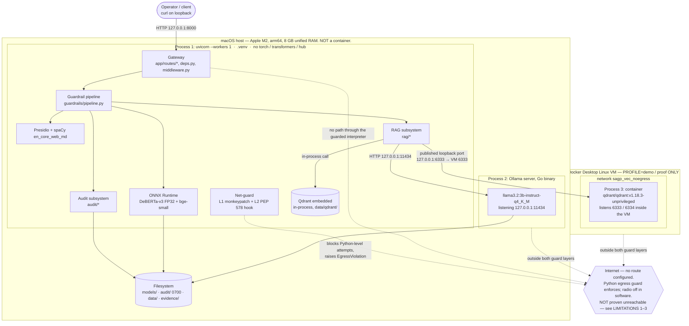

# Architecture

The deep technical reference for `sagp` — process boundaries, the numbered request and ingest paths, the
data model, module dependency rules, and the concurrency, memory and fail-closed models. It is derived
from and must stay consistent with [BLUEPRINT.md](BLUEPRINT.md) (authoritative) and [PLAN.md](PLAN.md).

> As of 2026-08-01 the code this document describes is **built and tested** (M0–M14; 258 tests pass,
> `make smoke` is 14/14). A few figures are now MEASURED and their markers are dropped — the injection
> ONNX session RSS (0.30 GB, OQ-1 resolved), the embedding parity gate (1.6e-07), and the M6 guardrail
> metrics in `docs/metrics/latest.json`. Every number that has **not** been measured on the target M2
> still carries an explicit `(ESTIMATE)`, `(UNVERIFIED)` or **OPEN QUESTION** marker — every latency
> and every RAM total remains a projection. Do not quote an estimate from this file as a fact.

---

## 1. Goals and non-goals

### Goals

| # | Goal | How it is judged |
|---|---|---|
| G1 | Run a local LLM with retrieval over a local PDF corpus with **no network egress** from the guarded interpreter | The 9 offline assertions in BLUEPRINT §9.2, each paired with a positive control |
| G2 | **De-identify** personal data before anything reaches the model | `<EMAIL_ADDRESS_1>` appears in the prompt sent to Ollama, the real address does not — smoke check 12/14 |
| G3 | **Block prompt injection** before anything reaches the retriever or the model | Corpus metrics measured at M6 (`docs/metrics/latest.json`): headline recall **1.0** (floor ≥ 0.90); precision **0.81** and benign FPR **0.32** *miss* their targets (0.85 / 0.10) and are OPEN `known_gaps`, severity medium (GUARDRAILS §10.2) |
| G4 | Treat **retrieved document text as untrusted** — the primary threat is a malicious document author | Ingest-time per-chunk scan, the per-collection `<collection>__quarantine` sibling, assembled-context re-scan (C19) |
| G5 | **Fail closed** everywhere. A guardrail that errors, times out, or returns a partial result blocks | `tests/security/test_guardrail_bypass.py` (AST + runtime spy); §10 of this document |
| G6 | Leak **no detector signal** across the trust boundary | Every detector block is HTTP 400, byte-identical body, padded to a fixed rejection deadline (120 ms placeholder) |
| G7 | Produce **tamper-evident, reproducible evidence** rather than assertions | Ed25519-signed `MANIFEST.json`, hash-chained audit log, signed evidence ledger |
| G8 | Fit inside **8 GB of unified memory** with headroom | §9 budget; `lifespan` refuses to boot above 90 % projected RSS |

### Non-goals — explicitly out of scope

| # | Non-goal | Why, and what would have to change |
|---|---|---|
| N1 | **Multi-tenancy** | There is one principal namespace, two shared bearer tokens, no user identity, no RBAC, no TLS. Rate limiting is in-process and keyed on `principal.id`. Multi-tenancy needs per-tenant collections, per-tenant vault isolation and a real identity provider. |
| N2 | **Multi-turn conversation** | The PII vault is request-scoped by construction (ADR-0005). A `messages` array of length > 1 returns **400 `UNSUPPORTED`** (C1). Cross-turn identity resolution is deferred to v2. |
| N3 | **Streaming tokens** | Citation validation and injection-compliance detection are undecidable on a partial response. The output guard is buffer-then-scan. SSE **stage events** carrying no content are shipped; token streaming is not (BLUEPRINT §0 row 30). |
| N4 | **Agentic tool use** | Nothing in the system grants the model an action. There is no tool schema, no function calling, no shell, no file write from a completion. Adding one re-opens every egress question the net-guard closes. |
| N5 | **Training or fine-tuning** | The runtime venv has no `torch` and no `transformers` (BLUEPRINT §3). Weights are read-only artifacts pinned by commit SHA and hashed into `MANIFEST.json`. |
| N6 | **A substitute for a physical air gap** | This is a rigorous, self-auditing **simulation**. The host keeps its Wi-Fi radio, Thunderbolt, Bluetooth and USB-NIC support. Native code (`grpcio`'s C core, ONNX Runtime, `ctypes`) can call `connect(2)` without entering CPython's socket layer. See [LIMITATIONS.md](LIMITATIONS.md) items 1–3. |
| N7 | Groundedness / hallucination scoring | C22d is an **out-of-range check on citation markers**, nothing more. It cannot detect a fabricated fact carrying a valid marker. |
| N8 | Non-repudiation | The Ed25519 key is generated on the host it attests to and timestamps are local-clock. Tamper-**evident**, not tamper-proof (ADR-0007). |

---

## 2. Context diagram

Three host-level process boundaries matter: the **uvicorn process**, the **Ollama server process**, and —
only under `PROFILE=demo` — the **Qdrant container** inside Docker Desktop's Linux VM.



### What the diagram is asserting

1. **FastAPI runs on the macOS host, in a normal user process.** It is not containerised, not in the
   Docker VM, and not behind a reverse proxy. `bin/sagp-serve` sources `.env.sealed` and then `exec`s
   `uvicorn --workers 1 --host 127.0.0.1`.
2. **Therefore the only host↔Qdrant path is the published loopback port.** Under `PROFILE=demo`,
   `docker-compose.yml` publishes `127.0.0.1:6333:6333` (and `6334` for gRPC). The client connects to
   `http://127.0.0.1:6333`. That published port is the entire mechanism.
3. **`host.docker.internal` is NOT the mechanism and must never appear in the client configuration.**
   That name resolves the *host* from *inside a container* — the opposite direction to the one we need.
   Nothing in `src/sagp/` runs inside a container, so nothing in `src/sagp/` has any use for it. If it
   ever appears in a config file or a compose service, that is a bug, not a fallback.
4. **Qdrant is the only vector store in this design** — there is no Chroma path — and it runs in one of
   two profiles. `SAGP_QDRANT_MODE=embedded` is the **default runtime backend**, chosen on RAM grounds:
   6.75 GB projected for the embedded profile against 7.60 GB projected for the demo/Docker profile,
   under an 8 GB ceiling (BLUEPRINT §0 row 8, §7 — both figures are projections, not measurements).
   `PROFILE=demo` (Docker, `qdrant/qdrant:v1.18.3-unprivileged`) is the **demonstration and proof path**:
   it is the network-isolation boundary this project exists to show, and it is what the proof harness
   targets. The §9 RAM table below is the embedded profile; every RAM number in this document names the
   profile it assumes.
   **The Docker path's isolation properties are UNTESTED, not isolated.**
   **OPEN QUESTION (OQ-4/OQ-5):** whether `internal: true` can coexist with a published loopback port on
   Docker Desktop 29.5.3, and whether `enable_ip_masquerade: "false"` actually blocks container egress
   there — where containers egress via a userland VM proxy rather than a host MASQUERADE rule — are both
   **untested**; the daemon is not running. `make spike-docker` (Phase 0) is specified to resolve them
   into ADR-0002, which stays **Proposed** until it does.
5. **Ollama is a separate Go process outside both guard layers.** It is covered only by the optional pf
   anchor (`make seal-pf`). Its binary `sha256` is in `MANIFEST.json` and `ollama --version` is asserted
   at startup. See [THREAT_MODEL.md](THREAT_MODEL.md).

---

## 3. Components

### 3.1 Gateway — `src/sagp/app/`

**Responsibility.** Terminate HTTP on loopback, authenticate the bearer token into a `Principal`,
enforce request caps and the rate limit, run the guardrail pipeline **as FastAPI dependencies**, and
render every failure into the uniform error surface.

**Key modules.** `main.py` (`create_app()` + `lifespan`), `deps.py` (`@lru_cache` singletons +
`get_principal()`), `schemas.py`, `middleware.py` (request-ID, timing, rejection-latency floor,
exception→HTTP, audit flush), `ratelimit.py`, `routes/{health,chat,ingest,admin,airgap}.py`.

**Must never.** Run guardrails as `BaseHTTPMiddleware` — Starlette's `ExceptionMiddleware` sits *inside*
user middleware and would degrade typed 400s into opaque 500s. Return a score, threshold, rule ID,
matched substring, model name, window index or entity type in any client-facing body. Expose a debug or
`/v1/raw` route. Reach `OllamaClient` from any path that has not run `pipeline.run_input()`.

### 3.2 Guardrail pipeline — `src/sagp/guardrails/`

**Responsibility.** Ordered, timed, short-circuiting execution of every input and output stage, and
assembly of the audit payload describing what each stage decided.

**Key modules.** `pipeline.py`, `base.py` (`Guardrail` Protocol, `GuardrailResult`, `Decision`),
`normalize.py`, `placeholders.py`, `deobfuscate.py`, `heuristics.py`, `injection/{scanner,onnx_backend,
labels,selftest}.py`, `pii.py`, `presidio_factory.py`, `recognizers.py`, `vault.py`, `aliases.py`,
`output.py`, `registry.py` (`build_pipeline()` — the single wiring point for **both** chat and ingest).

**Must never.** Wrap a stage in `try/except: pass`. Expose a `*_FAIL_MODE=open`, `*_DISABLED`, or
`skip_guardrails` switch. Hardcode the classifier label index — `INJECTION_IDX` is resolved from
`config.json`'s `id2label` at boot with **casefolded** alias matching (the real map is
`{"0": "SAFE", "1": "INJECTION"}`). Average the heuristic score with the classifier score; they are
combined by **OR** at the policy layer. Persist the vault.

### 3.3 RAG subsystem — `src/sagp/rag/`

**Responsibility.** PDF extraction with hidden-text detection, deterministic chunking, ONNX embedding,
vector search, and assembly of the single canonical prompt string.

**Key modules.** `loaders.py` (pypdf 6.14.2 + `visitor_text` hook), `chunking.py` (page-first,
bge-tokenizer-aware, 320 tokens / 64 overlap, min 32 — a pure function), `embeddings.py`
(CLS pooling → L2 normalize, 384-d, query prefix **iff** `is_query=True`), `vectorstore.py` (Protocol),
`qdrant_store.py`, `retriever.py`, `prompt.py`, `ingest.py`.

**Must never.** Mean-pool (silently halves recall). Apply the query prefix to documents. Use
`client.search()` — removed in qdrant-client 1.16.0; use `query_points(...)`, read `.points`, pass
`query_filter=`. Build a prompt string anywhere other than `prompt.py`. Put retrieved content in the
**system** role — it goes in the user role, inside nonce delimiters. Return a `Hit.score` that is not a
cosine similarity.

### 3.4 LLM runtime — `src/sagp/llm/` + the Ollama process

**Responsibility.** One buffered, non-streaming generation call to a loopback-bound Ollama server.

**Key modules.** `base.py` (`LLMClient` Protocol), `ollama_client.py` (client forced to
`http://127.0.0.1:11434`, 120 s timeout, token accounting), `fake.py` (`FakeLLM`, deterministic, used by
~90 % of tests), `prompts/system_rag.txt` (its `sha256` goes into every audit record) and
`prompts/refusal.txt`.

**Must never.** Pass `num_ctx` per request — it forces a full model reload; context length is set once
via `OLLAMA_CONTEXT_LENGTH=4096` in `.env.sealed`. Stream. Cache completions keyed by raw prompt. Fall
back to any hosted API. Be reachable from a route that skipped the pipeline.

### 3.5 Vector store — Qdrant

**Responsibility.** Cosine-similarity retrieval over 384-d vectors, with payload filtering that keeps
`guard.verdict == "quarantined"` chunks permanently out of results, plus a per-collection
`<collection>__quarantine` sibling for admin review — one quarantine collection per corpus collection,
which the retriever refuses to open (`is_quarantine_name`), so quarantined chunks are unreachable by
construction.

**Key modules.** `rag/vectorstore.py` (the Protocol), `rag/qdrant_store.py` — one class over three
modes: `embedded(path=data/qdrant)`, `server(url=http://127.0.0.1:6333)` under `PROFILE=demo`, and
`memory(":memory:")` for tests.

**Must never.** Bind to anything but loopback. Be treated as a trust boundary: under the shipped
`ingest_mode=raw` it holds **real, unmasked** personal data, protected by loopback binding, filesystem
permissions and FileVault — not by any guardrail (ADR-0006, LIMITATIONS item 11). Be queried with an
embedder whose `embed_model`/`embed_revision` differ from the stored payloads — see §6.4.

### 3.6 Audit subsystem — `src/sagp/audit/`

**Responsibility.** A closed-schema, append-only, hash-chained JSONL record of every decision, written
and `fsync`ed **before** any response is returned.

**Key modules.** `events.py` (`AuditEvent`, `extra="forbid"`, `frozen=True`), `sink.py` (append-only
JSONL, `fsync`, mode `0600` in a `0700` directory, daily rotation with a carry-over record),
`hashing.py` (domain-separated `hmac_token`, `sha256_hex`, `chain_digest`), `verify.py`
(`verify_chain() → ChainReport(ok, first_bad_seq, reason)`), `scrub.py` (`assert_no_raw_values()`),
`quarantine.py` (offending text, referenced from the audit record by `incident_id` only),
`redactors.py` (a root `logging.Filter`).

**Must never.** Contain raw PII, raw prompts, completions, retrieved text, or vault mappings. Accept an
undeclared field. Be the thing that fails silently: a write or scrub failure is a **503 with the
response withheld** (C25). Claim non-repudiation.

### 3.7 Net-guard — `src/sagp/netguard/`

**Responsibility.** Two independent egress layers, artifact integrity, and the lifecycle state machine.

**Key modules.** `egress.py` (L1 monkeypatch of `socket.socket.connect`/`getaddrinfo` **plus** L2
`sys.addaudithook` on PEP 578 socket, `subprocess.Popen`, `os.system`, `os.exec*`, `os.spawn*` and
`ctypes.dlopen` events), `manifest.py` (`generate | verify(full|quick) | sign | check-sig`, Ed25519),
`phase.py` (`BOOTSTRAP → PROVISION → OPERATE`, with `VERIFY`), `evidence.py`, `probes.py` (shared by
both the tests and the evidence report). Bootstrapped by `airgap_guard_boot.py` beside a `.pth` in
site-packages, which reads `.airgap/state.json` — never an env var.

**Must never.** Verify the manifest in `quick` mode at boot (`full`, always, ~3 s on M2 (ESTIMATE)).
Treat a generic `ConnectionError` as proof — every assertion is on the `EgressViolation` **type**.
Claim to cover native code, child processes it did not spawn, Ollama, or Docker. Report
`network_calls_attempted: 0`; the field is `python_egress_attempts_blocked`.

---

## 4. The request path — `POST /v1/chat`

This is the heart of the document. It reproduces BLUEPRINT §5.7 in full. Guardrails run as **FastAPI
dependencies**, never as `BaseHTTPMiddleware`.

> Numbering note: BLUEPRINT §5.7 is the authoritative expansion and runs **C0–C26**; PLAN.md §4 carries
> a condensed view of the same path. The two orderings that any condensation must preserve: chunks are
> **masked before** the context is assembled, and the re-scan runs over the **assembled masked context**
> — so C17 precedes C18 precedes C19, and the C15 refusal gate and the C26 vault clear both exist. Where
> BLUEPRINT names no symbol, the `module.function` below is the contract this document fixes for
> implementation.

| # | Stage | `module.function` | Fail-closed behaviour |
|---|---|---|---|
| C0 | Bearer → `Principal`; rate-limit bucket by `principal.id` | `app/deps.get_principal` → `app/ratelimit.TokenBucket.consume` | invalid → **401**; over limit → **429** |
| C1 | Schema `{message: str, collection: str}`; a `messages` array of len > 1 | `app/schemas.ChatRequest` (pydantic) | → **400 `UNSUPPORTED`** |
| C2 | `len(message) > SAGP_MAX_INPUT_CHARS` (8000) | `app/schemas.ChatRequest` | → **413 `INPUT_TOO_LARGE`** |
| C3 | `norm, flags = normalize(message)` | `guardrails/normalize.normalize` | `TAG_CHARS` or `BIDI_OVERRIDE` in flags → **400 `PROMPT_REJECTED`** |
| C4 | Heuristics over `norm` → weighted score + rule IDs | `guardrails/heuristics.score` | `DELIMITER_SPOOF` → **400** |
| C5 | Deobfuscate `base64/base32/hex/rot13/leet/reverse/spaced`, depth 2, 256 KB cap; each decoded surface is `normalize()`-d and joins **both** the C6 injection scan and the C10 BLOCK-list scan | `guardrails/deobfuscate.expand` | decode bomb / cap exceeded → **400** |
| C6 | Injection classifier over `{raw, norm, *decoded}`; `max_length=512`, `stride=128`, cap `SAGP_MAX_WINDOWS=16`; `score = max` | `guardrails/injection/scanner.InjectionScanner.scan` → `injection/onnx_backend.OnnxScorer.run` | `truncated=True` → **400** ("too long to scan" never means allowed). Exception or > 2000 ms → **503 `GUARDRAIL_UNAVAILABLE`** |
| C7 | Policy: `max(classifier, heuristic_weight) >= 0.85` | `guardrails/injection/scanner.InjectionScanner.decide` | → **400 `PROMPT_REJECTED`** |
| C8 | `neutral, n = neutralize_placeholders(norm)` | `guardrails/placeholders.neutralize_placeholders` | `n > 0` → flag + audit; prompts are neutralized, **not** blocked |
| C9 | Presidio `analyze(neutral, INGRESS)`, `default_score_threshold=0.50`, wall-clock cap 3000 ms | `guardrails/pii.PIIGuardrail.analyze` → `presidio_factory.get_analyzer` | exception, timeout, or **any recognizer regex timeout** → **503**. Never a partial result set at 200 |
| C10 | BLOCK-list check over `{neutral, *decoded-normalized}`: `CREDIT_CARD, IN_AADHAAR, US_SSN, IBAN_CODE, US_BANK_NUMBER, CRYPTO, MEDICAL_LICENSE, API_KEY, PRIVATE_KEY` (scanning the decode set closes the encoded-credential bypass) | `guardrails/pii.PIIGuardrail.check_block_list` | any hit → **400 `PROMPT_REJECTED`** — identical status, body and timing to C7 |
| C11 | `resolve_person_aliases(neutral, results, vault, origin="prompt")` — longest-first, strict subset, exactly-one-superset, **same origin only** | `guardrails/aliases.resolve_person_aliases` | ambiguous → mint a fresh placeholder (over-mask, never cross-link) |
| C12 | `anonymize(neutral, results, {"DEFAULT": OperatorConfig("vault_placeholder", {"vault": vault})})` → `masked_prompt` | `guardrails/pii.PIIGuardrail.anonymize` → `vault.VaultPlaceholder.operate` | `SAGP_MAX_VAULT_ENTRIES=2000` exceeded → **400** (a vault-exhaustion input is an attack) |
| C13 | Embed **`neutral`** — unmasked, normalized, `is_query=True` | `rag/embeddings.Embedder.encode` | embed exception or > 2000 ms → **503** |
| C14 | `query_points(collection, query=vec, limit=6, score_threshold=0.35, query_filter=must_not guard.verdict=="quarantined", with_payload=True)` | `rag/retriever.Retriever.retrieve` → `rag/qdrant_store.QdrantStore.query` | store exception or > 3000 ms → **503** |
| C15 | No hit ≥ `STRONG=0.50` → return `refusal.txt`, **no LLM call**, 200 with `decision="refuse_insufficient_context"` | `rag/retriever.Retriever.gate` + `llm/prompts/refusal.txt` | deterministic and auditor-testable |
| C16 | Per retrieved chunk: `normalize()` → `neutralize_placeholders()` | `rag/retriever.Retriever.sanitize_hits` | `n > 0` → **drop the chunk** + high-severity alarm (tamper signal) |
| C17 | `BatchAnalyzerEngine.analyze_iterator(chunks, "en", batch_size=6, n_process=1)` with EGRESS profile (0.35); `anonymize` each with the **same vault**, `origin=f"doc:{sha}"`. BLOCK-list **rejection** NOT applied to chunks — but block-tier entities ARE masked here (binary / egress 0.40; GUARDRAILS §5.1), so nothing leaks unmasked | `guardrails/pii.PIIGuardrail.mask_chunks` | exception → **503** |
| C18 | **Budget-select** masked chunks by retrieval score until under `SAGP_MAX_CTX_CHARS=7000` (**trim happens here, before the C19 re-scan**, so the scanned string is the delivered string), then `nonce = secrets.token_hex(8)`; each surviving chunk wrapped `<<<UNTRUSTED_DOCUMENT_{nonce}_S{i}>>> … <<</UNTRUSTED_DOCUMENT_{nonce}_S{i}>>>`. No datamarking. Retrieved content goes in the **user** role | `rag/prompt.build_prompt` + `utils/text.trim_to_budget` | the sole builder of the final prompt string; budget leaves 0 chunks → C15 refusal |
| C19 | **Drop-and-continue** injection re-scan at threshold 0.90, in two parts. **C19a** scans each masked retrieved chunk on the `retrieval` surface and **drops only the flagged chunks** — a single poisoned chunk must not deny service to a query that also retrieved good ones. **C19b**, after the C18 budget trim, re-scans the **fully assembled** masked string as one unit (4–5 windows, so corroboration is operative here; `max` governs, corroboration only escalates — GUARDRAILS §4.3) | C19a `guardrails/pipeline.InputGuardrail.filter_context`; C19b `.scan_context` | flagged chunk → dropped; **all** chunks dropped → C15 refusal (`decision="refuse_context_flagged"`, no LLM call); assembled-string hit → same refusal, no LLM call; exception → **503** |
| C20 | Assert the re-scanned assembled context is byte-identical to the user-role payload C21 sends (`test_final_bytes_were_scanned`, §9.4) | `guardrails/pipeline` invariant | any divergence is a bug, not a runtime path |
| C21 | `ollama.Client("http://127.0.0.1:11434").chat(model, messages, stream=False, keep_alive="30m", options={temperature:0.1, top_p:0.9, num_predict:512, seed:42})`, timeout 120 s. **Never pass `num_ctx` per request** | `llm/ollama_client.OllamaClient.generate` | timeout or exception → **503** |
| C22a | Output structural: strip markdown images/links; nonce delimiter or a system-prompt n-gram present in the output | `guardrails/output.structural_check` | → **block**, return `refusal.txt` — closes the zero-click exfil channel |
| C22b | Presidio `analyze(response_raw, EGRESS 0.35)` → `anonymize` with the **same vault** → `masked_response` | `guardrails/output.egress_pii` | exception → **503** |
| C22c | Presidio `analyze(normalize(response_raw), EGRESS 0.35)`; if it finds **more** entities than C22b | `guardrails/output.divergence_check` | → **block**, return `refusal.txt`. Fail-closed; requires no offset mapping |
| C22d | Citation range check on `\[S(\d+),\s*p\.(\d+)\]` against supplied blocks/pages | `guardrails/output.citation_range` | out of range → strip (`warn`) or refuse (`strict`) |
| C23 | Rehydrate **iff** `"pii:reveal" in principal.scopes and SAGP_REHYDRATE_OUTPUT == 1`; single-pass `re.sub`; unknown placeholders left **verbatim** | `guardrails/placeholders.rehydrate` | never a global fallback map |
| C24 | Re-run C22a on the **final returned string**; record `completion_pre_rehydrate_sha256` **and** `completion_returned_sha256` | `guardrails/output.structural_check` + `audit/hashing.sha256_hex` | the scanning boundary is stated, not overclaimed |
| C25 | Write `AuditEvent`, `fsync`, chain link | `audit/sink.AuditSink.write` + `audit/scrub.assert_no_raw_values` | write or scrub failure → **503**, response **not** returned |
| C26 | `finally: vault.clear()` | `guardrails/vault.PiiVault.clear` | unconditional; see LIMITATIONS item 12 on heap residue |

**Uniform rejection surface.** Every *detector* 400 (C3–C12) returns exactly:

```json
{"error":{"code":"PROMPT_REJECTED","message":"Your request was rejected by the security policy.","incident_id":"<uuid4>"}}
```

and terminates at a **fixed rejection deadline** via `utils/timing.constant_time_floor` — a single
wall-clock target every detector reject is padded to, not a per-detector minimum (the `120 ms` value
is a placeholder that `test_oracle_uniformity` calibrates above the slowest measured path at M13; see
GUARDRAILS §1). C1 `UNSUPPORTED` (schema, pre-detector) is the sole exemption. No score, threshold,
rule ID, matched substring, model name, window index or entity type crosses the boundary. All of it is in the audit record,
retrievable at `GET /v1/admin/incident/{id}`. There is no `admin` scope — there are exactly three
scopes (`chat`, `ingest`, `pii:reveal`) across two bearer tokens, and `/v1/admin/*` is gated on
`pii:reveal` (`SAGP_API_TOKEN_REVEAL`).

### 4.1 The three orderings that matter

**(a) Injection detection runs BEFORE masking (C3–C7 before C9–C12).**
Presidio replaces entity spans with placeholders. If masking ran first, an attacker who embeds the
payload inside something Presidio recognises gets the classifier to scan `<PERSON_1>` instead of the
attack text — the mask *is* the evasion. Concretely, a prompt whose injection instructions are phrased
as a fake person or organisation name would arrive at the scanner already redacted to a two-token
placeholder that scores as benign. Scanning first means the classifier always sees the adversary's
actual bytes. This ordering is invariant 7 in `CLAUDE.md` ("never mask before scanning") and is
enforced by the shipped pipeline (M10); a dedicated `tests/unit/test_pipeline_order.py` asserting stage
identity is not yet part of the suite, so the order rests on the pipeline wiring and the e2e path.

**(b) C13 embeds `neutral` — the normalized, unmasked query, not `masked_prompt`.**
`neutral` is normalized and placeholder-neutralized but **not** anonymized (it is *not* the raw
message — normalization has already folded homoglyphs/fullwidth and stripped smuggling chars). Embedding the masked string
would destroy retrieval: under `ingest_mode=raw` (ADR-0006) the corpus is stored unmasked, so a masked
query and a raw corpus live in different lexical distributions. A query reduced to
`"what is <PERSON_1>'s <EMAIL_ADDRESS_1>"` carries almost no retrievable signal — the placeholders are
per-request ordinals with no semantic content, and bge-small has never seen them. The result would not
be an error; it would be a quiet collapse to zero hits above `MIN=0.35`, which the system would report
as `refuse_insufficient_context` and an operator would read as "the document doesn't cover that".
Masking is applied to what reaches the **model** (C12 output) and to what reaches the **caller** (C22b),
never to what reaches the **index**.

**(c) C3 normalizes BEFORE C8 neutralizes placeholders.**
`normalize()` applies NFKC. NFKC folds fullwidth `＜` (U+FF1C) to `<` and `＞` (U+FF1E) to `>`. If
`neutralize_placeholders()` ran first, it would scan for the literal ASCII `<PERSON_1>` pattern, miss
the fullwidth form `＜PERSON_1＞` entirely, and then NFKC would fold that survivor into a perfectly
valid ASCII placeholder inside the text that reaches C12 and C23 — a user-supplied placeholder that
rehydration would later treat as real. Normalizing first collapses every equivalent encoding into the
one form the placeholder regex is written against. The same argument applies to any Unicode-equivalent
spelling of the delimiter characters. `placeholders.py` exports exactly **one** `PLACEHOLDER_RE`
constant used by both `neutralize()` and `rehydrate()`, and a property test (shipped at M3) asserts that
anything `rehydrate` matches, `neutralize` also matches.

---

## 5. The ingest path — `POST /v1/ingest` and `scripts/ingest.py`

Reproduces BLUEPRINT §5.6. The same `registry.build_pipeline()` wires both paths.

| # | Stage | `module.function` | Fail-closed behaviour |
|---|---|---|---|
| I1 | Bearer token → `Principal` with scope `ingest` | `app/deps.get_principal` | missing/invalid → **401**, generic body |
| I2 | Read local bytes, `sha256`, size cap `SAGP_MAX_DOC_BYTES=52428800` | `app/routes/ingest.py` + `audit/hashing.sha256_hex` | over cap → **413** |
| I3 | `pypdf` extract per page + hidden-text visitor (tiny font < 1.0 pt, off-MediaBox `tm`, `/RenderMode 3`) | `rag/loaders.load_pdf` (`page.extract_text(extraction_mode="layout", visitor_text=_visitor)`) | extraction exception → **abort whole ingest**, delete any partial points by `doc_sha256` |
| I4 | `normalize()` per page, then `neutralize_placeholders()` | `guardrails/normalize.normalize` → `guardrails/placeholders.neutralize_placeholders` | tag/bidi chars present → page **quarantined**, high-severity alarm |
| I5 | Chunk: page-first, 320 tokens / 64 overlap, min 32 | `rag/chunking.chunk_pages` | pure function; no failure mode |
| I6 | Presidio `analyze` (INGRESS 0.50) per chunk → record entity **types + counts** into the payload. **No masking. BLOCK list NOT applied** | `guardrails/pii.PIIGuardrail.analyze_only` | analyze exception/timeout → chunk **quarantined** |
| I7 | Injection scan per chunk: heuristics + classifier over `raw` **and** `normalized`, take max. Verdict `clean` (< 0.70) / `suspect` (0.70–0.95) / `quarantined` (≥ 0.95, high-confidence heuristic, or `truncated=True`) | `guardrails/injection/scanner.InjectionScanner.scan` | scanner exception/timeout → **quarantined**, never `clean` |
| I8 | `quarantined` → the per-collection `<collection>__quarantine` sibling (never retrieved — the retriever refuses to open it, `is_quarantine_name`; admin-reviewable). Others → main collection | `rag/qdrant_store.QdrantStore.upsert` + `rag/vectorstore.quarantine_name` | routing is decided before embedding, not after |
| I9 | Embed the stored chunk text, `is_query=False` (no query prefix) | `rag/embeddings.Embedder.encode` | exception → abort ingest, roll back by `doc_sha256` |
| I10 | Delete superseded `doc_sha256` for the same basename **first**, then `upsert` with `uuid5(NS, f"{sha}:{idx}")` | `rag/ingest.ingest_document` + `utils/ids.point_id` | a crash mid-run leaves a *partial* (re-runnable) index, never a duplicated one |
| I11 | Write `AuditEvent(event_type="ingest")`, `fsync` | `audit/sink.AuditSink.write` | audit write failure → **request fails** |

**Scan budget, as built:** once per chunk at **ingest** (I7), and at retrieval the C19 re-scan runs in
two parts — **C19a** scores each masked retrieved chunk on the `retrieval` surface and drops only the
flagged ones (drop-and-continue), then **C19b** re-scans the assembled masked context as one unit. The
per-chunk pass is what lets one poisoned chunk be dropped without denying the whole request; the
assembled pass is what catches a payload split across chunks. Adjacent-window corroboration is
**inoperative** at I7 and at C19a — a 320-token chunk is exactly one 512-token window — and operative
only at C19b, where the assembled context spans 4–5 windows.

---

## 6. Data model

### 6.1 Core types — `src/sagp/types.py`

`types.py` imports nothing from `sagp.*` and nothing from any third-party library except `pydantic`
and the stdlib. Field lists below are the design contract; they are finalised at M0/M2.

```python
class TextArtifact(BaseModel):        # any unit of text that can be scanned
    text: str                         # the current (possibly normalized) text
    origin: str                       # "prompt" | f"doc:{doc_sha256}" | "completion"
    flags: list[str] = []             # NFKC_CHANGED, ZERO_WIDTH, TAG_CHARS, BIDI_OVERRIDE, PDF_TINY_FONT…
    source_path: str | None = None
    page: int | None = None

class Chunk(BaseModel):
    doc_sha256: str
    idx: int                          # ordinal within the document
    page: int
    text: str                         # RAW under ingest_mode=raw — masked only at retrieval
    token_count: int

class Hit(BaseModel):
    point_id: str                     # uuid5(NS, f"{doc_sha256}:{idx}")
    score: float                      # ALWAYS cosine similarity, for every backend
    chunk: Chunk
    payload: dict                     # the Qdrant payload, §6.3

class ScanResult(BaseModel):
    score: float                      # max over windows/surfaces
    verdict: str                      # "clean" | "suspect" | "quarantined" (ingest)
    rule_ids: list[str]               # heuristic rule IDs that fired
    windows: int
    truncated: bool                   # True is ALWAYS fail-closed, on every surface
    elapsed_ms: int

class GuardrailDecision(BaseModel):
    stage: str                        # "C7", "C10", "C19", "C22c" …
    decision: str                     # "allow" | "block" | "refuse" | "unavailable" | "flag"
    reason_code: str                  # internal only — never crosses the HTTP boundary
    elapsed_ms: int

class Principal(BaseModel):
    id: str                           # stable, non-secret identifier used as the rate-limit key
    scopes: frozenset[str]            # {"chat"} | {"chat","ingest"} | + {"pii:reveal"}
    token_sha256: str                 # hash of the presented token; never the token itself
```

### 6.2 `AuditEvent` — `src/sagp/audit/events.py`

`extra="forbid"`, `frozen=True`. A closed schema is what makes "never log raw PII" checkable rather
than aspirational: a new signal cannot be smuggled in as a free-form dict. Adding a field requires
three edits in one commit — the field, a `docs/COMPLIANCE.md` row, and a `test_audit_no_pii.py` case
(`CLAUDE.md` invariant 1 — audit records carry entity types and counts only).

| Group | Fields |
|---|---|
| Identity | `seq`, `ts_local`, `request_id`, `incident_id \| None`, `event_type` (`chat`/`ingest`/`admin`/`scrub_violation`), `principal_id` |
| Chain | `prev_digest`, `digest` (`chain_digest(prev_digest, canonical_json(body))`) |
| Provenance | `config_hash`, `manifest_root_hash`, `seal_generation`, `sagp_version`, `system_prompt_sha256`, `embed_model`, `embed_revision`, `llm_model` |
| Decision | `decision`, `stages: list[GuardrailDecision]`, `injection_score`, `heuristic_rule_ids`, `normalize_flags`, `truncated` |
| PII | `entity_types_counts: dict[str,int]`, `pii_token_hmacs: list[str]`, `vault_size`, `rehydrated: bool` |
| Content **hashes only** | `prompt_sha256`, `masked_prompt_sha256`, `completion_pre_rehydrate_sha256`, `completion_returned_sha256`, `retrieved_point_ids: list[str]` |
| Egress | `python_egress_attempts_blocked` |
| Timing | `total_ms`, per-stage `elapsed_ms` inside `stages` |

`pii_token_hmacs` is **not** a hash of the placeholder — placeholders are per-request ordinals and carry
zero information. It is `HMAC(key, f"entity:{type}\x1f{normalize(type, value)}")`, which lets an auditor
answer "did this identity appear in two different incidents?" without storing the identity.

### 6.3 Qdrant point payload schema

Point ID: `uuid5(NAMESPACE, f"{doc_sha256}:{idx}")` — deterministic, so re-ingest overwrites rather
than duplicates. Vector: 384-d, `Distance.COSINE`.

```jsonc
{
  "doc_sha256":     "9f2c…",              // I2
  "source_basename":"employee_handbook.pdf",
  "collection":     "handbook",
  "idx":            17,                    // chunk ordinal
  "page":           4,
  "text":           "…",                   // RAW chunk text (ingest_mode=raw, ADR-0006)
  "token_count":    312,
  "ingested_ts":    "2026-07-27T09:14:02Z",

  "embed_model":    "BAAI/bge-small-en-v1.5",
  "embed_revision": "5c38ec7c405ec4b44b94cc5a9bb96e735b38267a",
  "embed_pooling":  "cls_l2",              // guards against a future mean-pooling regression

  "pii": {                                 // I6 — types and counts ONLY, never values
    "entity_types": {"PERSON": 2, "EMAIL_ADDRESS": 1},
    "profile":      "ingress_0.50"
  },

  "guard": {                               // I7
    "verdict":      "clean",               // "clean" | "suspect" | "quarantined"
    "score":        0.11,
    "rule_ids":     [],
    "truncated":    false,
    "scanner":      "protectai/deberta-v3-base-prompt-injection-v2",
    "scanner_revision": "90c9989b1a342275dd0d1a95aad283c04e075671",
    "loader_flags": []                     // PDF_TINY_FONT | PDF_OFFPAGE_TEXT | PDF_INVISIBLE_RENDER
  }
}
```

The retrieval filter is `must_not guard.verdict == "quarantined"` (C14). `suspect` chunks **are**
retrievable — they are the reason C19 exists.

### 6.4 Why an embed-model mismatch is a hard error

`embed_model` and `embed_revision` are written into every point and checked against the running embedder
when a collection is opened. A mismatch is a **startup/503 failure**, never a query.

The reason is that the failure is otherwise invisible. A different checkpoint, a different revision, or
a mean-pooling regression produces vectors in a different space. Cosine scores against the stored
vectors then drift below `MIN=0.35`, `query_points` returns nothing above threshold, C15 fires, and the
caller receives a well-formed 200 carrying `refusal.txt` and `decision="refuse_insufficient_context"`.
That is **byte-identical to correct behaviour on an unanswerable question**. There is no error, no
alarm, no latency change — recall simply collapses to zero and the system looks conservative rather than
broken. Retrieval quality has no self-evident ground truth at request time, so nothing downstream can
notice. Checking two strings at collection-open time converts a silent, indefinite correctness failure
into a loud, immediate availability failure, which is the trade this project makes everywhere.

The same argument motivates `embed_pooling` in the payload: CLS vs mean pooling is the single most
likely hand-rolled-ONNX regression (BLUEPRINT §5.5), and it degrades recall without ever raising.

---

## 7. Module boundaries

Dependency direction is **downward only**. An import that points back up is a bug that `make lint`
must reject.

```
        app/            (routes, deps, middleware, schemas)
          │
          ▼
     guardrails/  ──▶  audit/          rag/  ──▶  llm/
          │                             │
          └──────────┬──────────────────┘
                     ▼
        config.py · errors.py · types.py · utils/
                     ▲
                netguard/   (imports config/errors only; imported by app.main + the .pth bootstrap)
```

| Layer | May import | **Forbidden imports** |
|---|---|---|
| `types.py` | stdlib, `pydantic` | anything from `sagp.*`; any third-party library other than pydantic |
| `config.py` | stdlib, `pydantic-settings` | anything from `sagp.*` (it is the root of the graph) |
| `errors.py`, `utils/` | stdlib | `sagp.app`, `sagp.guardrails`, `sagp.rag`, `sagp.llm` |
| `audit/` | `config`, `errors`, `types`, `utils` | `sagp.guardrails`, `sagp.rag`, `sagp.llm`, `sagp.app` — the sink must not be able to call the thing it records |
| `guardrails/` | `config`, `errors`, `types`, `utils`, `audit` | `sagp.rag`, `sagp.llm`, `sagp.app` — a guardrail that can call the LLM is a bypass waiting to happen |
| `rag/` | `config`, `errors`, `types`, `utils`, `guardrails` | `sagp.app`, `sagp.llm` **from `retriever.py`/`ingest.py`** (only `app/routes/chat.py` composes retrieval with generation) |
| `llm/` | `config`, `errors`, `types`, `utils` | `sagp.guardrails`, `sagp.rag`, `sagp.app` — the client must be unaware of what guarded it |
| `netguard/` | `config`, `errors`, stdlib | everything else; `airgap_guard_boot.py` must import **nothing** from `sagp` (it runs before the package exists on `sys.path`) |
| `app/` | everything | a second app factory carrying dev bypasses — `sagp.app.main` must not be able to import one |

**Whole-runtime import bans**, enforced by `tests/security/test_no_network_imports.py` (AST, not
runtime): `torch`, `transformers`, `huggingface_hub`, `sentence_transformers`, `optimum`, `onnx`,
`chromadb`, `requests`, `urllib.request`, `spacy.cli`. `httpx` is permitted only inside
`llm/ollama_client.py` and the qdrant client's own dependency tree. `tldextract` is permitted only
inside `guardrails/recognizers.py`, and only via the injected no-fetch `TLDExtract` instance.

Two additional invariants that are boundary rules in disguise: `presidio_factory.py` is the **only**
place `AnalyzerEngine`/`AnonymizerEngine` are constructed, and `rag/prompt.py` is the **only** place the
final prompt string is built.

---

## 8. Configuration model

### 8.1 Environment — the `SAGP_` prefix

`src/sagp/config.py` defines `Settings(BaseSettings, env_prefix="SAGP_")`. There is exactly one prefix.
Upstream variables (`HF_*`, `OLLAMA_*`, `TLDEXTRACT_CACHE`, `TOKENIZERS_PARALLELISM`) keep their real
names because they are read by other software.

Precedence, highest wins:

| Rank | Source | Notes |
|---|---|---|
| 1 | Explicit `Settings(...)` kwargs | tests only |
| 2 | Process environment | what `bin/sagp-serve` exports from `.env.sealed` **before** `exec`ing the interpreter |
| 3 | `.env` file | secrets written by `09_secrets.py` (`0600`); **present and read in OPERATE**, sourced by `bin/sagp-serve` alongside `.env.sealed` |
| 4 | Field defaults in `config.py` | the documented baseline |

`.env.sealed` must be sourced by the launcher rather than loaded by pydantic-settings, because
`HF_HUB_OFFLINE` and friends are read at **import** time by libraries that load before settings do — a
`.env`-loaded flag is a no-op (BLUEPRINT §0 row 28). At runtime the corresponding assertion is simply
that `huggingface_hub` is **not importable** at all.

Every threshold is validated `0.0 < t <= 1.0` at startup, and thresholds live in YAML rather than in
Python (`CLAUDE.md` invariant 12). A typo'd env var **refuses to boot** rather than silently
defaulting. There is no `*_FAIL_MODE`, no `*_DISABLED`, and no env var that weakens a control
(`CLAUDE.md` invariant 6 — fail-CLOSED).

Canonical caps and timeouts (BLUEPRINT §12):

```
SAGP_MAX_INPUT_CHARS      = 8000        SAGP_MAX_WINDOWS       = 16
SAGP_MAX_SCAN_UNIT_CHARS  = 20000       SAGP_MAX_CTX_CHARS     = 7000
SAGP_MAX_DOC_BYTES        = 52428800    SAGP_MAX_VAULT_ENTRIES = 2000

timeout_injection_ms = 2000 → 503       timeout_retrieve_ms = 3000 → 503
timeout_pii_ms       = 3000 → 503       timeout_llm_s       = 120  → 503
timeout_embed_ms     = 2000 → 503       timeout_request_s   = 180  → 503
rejection_deadline_ms      = 120   # placeholder; fixed deadline (not a floor), calibrated at M13
```

### 8.2 `config/guardrails.yaml` — see GUARDRAILS.md §8.1

**The canonical schema and every value in this file live in
[GUARDRAILS.md §8.1](GUARDRAILS.md#81-configguardrailsyaml). This document deliberately does not
reproduce them** — two copies of a hashed policy file drift, and a drifted copy changes block decisions.

It governs the pipeline stages in order: `normalize`, `heuristics` (including the block-outright rule
IDs `TAG_CHARS`, `BIDI_OVERRIDE`, `DELIMITER_SPOOF`, and the proposed, uncalibrated rule weights),
`deobfuscate`, `injection` (model pin, window policy, the four thresholds), `pii`, `context`, `output`,
`retrieval`, `rejection` and `limits`. Thresholds are **data, not code**, so changing one is a reviewable
diff — and the `sha256` of this file goes into **every** audit record (§8.4), which is what lets an
auditor join a decision to the exact policy that produced it.

One constraint this document depends on elsewhere:
`ingress_default_score_threshold` must be strictly greater than **0.40**, which is exactly
`LemmaContextAwareEnhancer.min_score_with_context_similarity` — at 0.40 a single nearby context word is
sufficient to promote a match. The startup validator enforces the inequality.

### 8.3 `config/entities.yaml` — see GUARDRAILS.md §8.2

**The canonical `block` / `mask` / `allow` tables — every entity, every ingress and egress threshold,
and the source recognizer for each — live in
[GUARDRAILS.md §8.2](GUARDRAILS.md#82-configentitiesyaml).** This document does not reproduce them, for
the same reason as §8.2: this file is hashed into every audit record, and a second copy that drifts is a
second policy.

Three points that the rest of this document leans on:

- **BLOCK** is applied at C10 to the **user prompt only** — never to ingested chunks (I6) or retrieved
  context (C17), because a handbook may legitimately contain an IFSC code.
- **`DATE_TIME` is an `allow` entity**: detected and audited, **not** masked. Masking dates destroys
  most answers. `NRP` and `URL` are likewise allow-only.
- Some entities are **binary**: Presidio's `validate_result` returning non-`None` forces the score to
  `MAX_SCORE` or `MIN_SCORE`, so `EMAIL_ADDRESS`, `CREDIT_CARD` and `IN_AADHAAR` carry `binary` where a
  number would otherwise be. Writing a threshold for one of them would be a lie about the mechanism.

The three custom-recognizer entities — `IN_IFSC`, `EMPLOYEE_ID`, `PROJECT_CODENAME` — are mask entities
sourced from `config/recognizers/*.yaml` alongside `secrets.yaml` (`API_KEY`, `PRIVATE_KEY`, both BLOCK).

### 8.4 The config hash

`config_hash = sha256(canonical_bytes(guardrails.yaml) || canonical_bytes(entities.yaml) ||
Σ canonical_bytes(recognizers/*.yaml))`, computed once at boot and written into **every** audit record
(§6.2). It is also reported by `GET /v1/admin/guardrails` and included in every evidence report.

This is what makes an audit record self-describing. Without it, "request 4f21 was allowed at 09:14" is
unfalsifiable a month later, because the thresholds that allowed it may have moved. With it, an auditor
can join a decision to the exact policy that produced it, and a threshold edit is visible as a
discontinuity in the log rather than as nothing at all.

---

## 9. Concurrency and memory

### 9.1 The concurrency model

| Control | Value | Why |
|---|---|---|
| uvicorn workers | **1**, mandatory | A second worker means a second spaCy pipeline and a second pair of ORT sessions — roughly +0.8 GB (ESTIMATE) against the 1.25 GB headroom the **embedded** profile projects (0.40 GB projected under `PROFILE=demo`) — both projections, neither measured |
| Sync guardrail offload | `anyio.CapacityLimiter(2)` | Never FastAPI's default ~40-thread pool. Forty concurrent Presidio calls would OOM the box before any rate limit bit |
| ORT `SessionOptions` | `intra_op_num_threads=4`, `inter_op_num_threads=1` | 8 cores total; 4 for the guardrail models leaves 4 for Ollama's decode loop. Oversubscribing makes both slower |
| Engine construction | lazy `@lru_cache` singletons in `app/deps.py`, warmed in `lifespan` | One `AnalyzerEngine`, one `AnonymizerEngine`, one injection `InferenceSession`, one embedder session, one `QdrantClient`, one `OllamaClient` per process. Lazy so that `import sagp` stays side-effect-free (smoke check 2/14); warmed at boot so the first request does not pay ~2–4 s of session init (ESTIMATE) |
| Ollama concurrency | `OLLAMA_NUM_PARALLEL=1`, `OLLAMA_MAX_LOADED_MODELS=1`, `OLLAMA_MAX_QUEUE=16` | One model resident, one decode at a time, queue rather than thrash |
| Rate limit | in-process token bucket keyed on `principal.id`, plus a near-miss burst alarm | Dies with the process; adequate for a single-tenant sealed box (non-goal N1) |

`_violations` in the egress guard is a `deque(maxlen=1000)` plus a monotonic counter. Stacks are
formatted **outside** the lock, only for the first 3 occurrences of each distinct
`(layer, operation, target)` triple, and stack formatting stops entirely above a per-second denial-rate
ceiling — otherwise a denial storm becomes its own denial of service.

**Denial of service by resource exhaustion is largely unmitigated on 8 GB.** A concurrent burst OOMs
before rate limits bite. One worker plus `CapacityLimiter(2)` is the whole defence
(LIMITATIONS item 17).

### 9.2 RAM budget — 8 GB hard ceiling

Reproduced from BLUEPRINT §7 with its markers intact. **This table is the embedded profile**
(`SAGP_QDRANT_MODE=embedded`, the default runtime backend): `llama3.2:3b-instruct-q4_K_M`,
`num_ctx=4096`, KV `q8_0`, embedded Qdrant, ONNX runtime. The demo/Docker profile (`PROFILE=demo`) is
the ~7.60 GB row in the variants table below. **Only the macOS baseline (measured) and the injection
classifier session (0.30 GB, OQ-1 resolved) are measurements** — every other line, and every total, is
a sum of estimates, not an observation (BLUEPRINT §14).

| Component | RSS (GB) | Basis |
|---|---|---|
| macOS baseline | 3.00 | measured, authoritative |
| Ollama server + model weights (2.0) + KV @ q8_0 (0.24) + compute graph/runtime (0.35) | 2.59 | **ESTIMATE** — verify with `ollama ps` (OQ-8) |
| CPython 3.11 + FastAPI + uvicorn + pydantic | 0.15 | **ESTIMATE** |
| onnxruntime runtime (one process, two sessions) | 0.12 | **ESTIMATE** |
| DeBERTa-v3-base **FP32** ONNX session | **0.30** | **MEASURED (OQ-1 resolved).** FP32, not INT8 (OQ-2 — INT8 inverts this checkpoint); ORT mmaps the weights, so FP32 matches the old INT8 projection |
| bge-small-en-v1.5 ONNX session (133 MB fp32) | 0.18 | **ESTIMATE** |
| spaCy `en_core_web_md` pipeline (24.0 MB vectors + weights) | 0.20 | **ESTIMATE** |
| Presidio registry + compiled regexes | 0.03 | **ESTIMATE** |
| Qdrant embedded (client + local segments, ≤ 50k vectors) | 0.08 | **ESTIMATE** |
| pypdf + transient page buffers | 0.05 | **ESTIMATE** |
| tokenizers + numpy + grpcio/httpx + misc | 0.05 | **ESTIMATE** |
| **App process total** | **1.16** | **ESTIMATE — sum of estimates** (only the 0.30 classifier line is measured); gate: refuse to boot above 1.40 |
| **SYSTEM TOTAL (embedded profile)** | **6.75** | **ESTIMATE — the OQ-1 classifier figure is now measured (0.30); every other line is still an estimate; headroom 1.25 GB, projected, not measured** |

Every total in the variants table is a **projected** verdict on **projected** arithmetic. None of it has
been measured on this M2.

| Variant | Total (projected) | Projected verdict (unmeasured) |
|---|---|---|
| Embedded profile (the table above) — the default runtime backend | **6.75** | fits with 1.25 GB projected headroom; the profile to ship |
| `PROFILE=demo` — Docker Qdrant, `mem_limit 512m`, Docker Desktop VM capped at 2 GB. The demonstration and proof path; its isolation is **untested** (OQ-4/OQ-5) | ~7.60 | projected to fit with no margin; close other apps |
| Classifier session RSS regresses above 0.30 GB (why the gate is 0.35, not 0.30) | ≤ 7.05 | did not happen — the FP32 session **measured 0.30 GB** (OQ-1); the 0.35 gate remains as headroom |
| FP32 ONNX classifier — **now the shipped runtime**, not a fallback (INT8 rejected, OQ-2) | 6.75 | ORT mmaps the weights, so FP32 **measured 0.30 GB** (not the once-feared 0.80) and does **not** force `llama3.2:1b`; no LLM downgrade needed |
| `en_core_web_lg` instead of `md` (embedded) | 7.35 | discouraged; +0.60 GB for +0.81 aggregate `ENTS_F` |
| `llama3:8b` @ ctx 2048, q8_0 KV, everything else stripped (embedded) | **9.28** | **projected NOT to fit.** Over by 1.3 GB |

**On `llama3:8b`, stated plainly:** there is no configuration in which it fits. macOS will compress and
swap rather than OOM, so it will *appear* to work — at 3–6 tok/s (ESTIMATE) with a 2–5 s stall
(ESTIMATE) at the head of every request while the guardrail models' pages fault back off the SSD. The
components paged out are precisely the idle security controls. That is a security-relevant
characteristic, not merely slowness. The app prints a loud startup warning when an `8b` tag is
configured on a host with < 16 GB.

Budgeted separately, outside steady state: `quantize_dynamic` needs ~3 GB transient and runs during
PROVISION **before** Ollama starts; full manifest verification streams ~4 GB at boot with a bounded
buffer (negligible RSS, ~2–3 s wall clock (ESTIMATE)).

**Enforcement.** `lifespan` sums the configured profile's expected RSS against
`psutil.virtual_memory().total` and refuses to boot above 90 % projected. `/readyz` reports measured RSS
per component.

---

## 10. Fail-closed matrix

There is exactly one fail mode: closed. Every row below is backed by a test in `tests/security/` or
`tests/integration/`; those suites exist and pass as of M11 (258 tests green overall).

| Component / condition | Behaviour | HTTP | Audit `decision` |
|---|---|---|---|
| Injection classifier **fails to load** at boot (missing/corrupt ONNX, `id2label` unresolvable, `selftest.py` red) | Process **refuses to start**. `lifespan` raises; uvicorn exits non-zero | *(no server; `/readyz` never becomes ready)* | `startup_failed` written before exit, `reason_code=classifier_selftest` |
| Injection classifier **times out** (> 2000 ms) or raises at request time (C6, C19) | Block. Vault cleared, no LLM call | **503 `GUARDRAIL_UNAVAILABLE`** | `unavailable` |
| Injection classifier reports `truncated=True` (> 16 windows) | Block on **every** surface — "too long to scan" never means allowed. At ingest the chunk is `quarantined` | **400 `PROMPT_REJECTED`** | `block` |
| **Presidio times out** (> 3000 ms wall clock, `anyio.fail_after` around the offloaded thread) at C9/C17/C22b | Block. Never a partial result set at 200 | **503** | `unavailable` |
| **Presidio recognizer regex timeout** (`regex.finditer(timeout=REGEX_TIMEOUT_SECONDS)`) | Block. `PIIGuardrail` wraps `analyze()` so a swallowed regex timeout cannot return a short result set. **OQ-6 RESOLVED-CONFIRMED** against `presidio-analyzer==2.2.364` source: `PatternRecognizer.__analyze_patterns` **catches `TimeoutError` per pattern, logs "skipping", and returns a partial set** — a real silent fail-open, which is exactly why M4 wraps the call and treats a per-pattern regex timeout as a guardrail failure | **503** | `unavailable` |
| **Qdrant unreachable** or erroring (C14, I8/I10) | Chat: block before any LLM call. Ingest: abort and roll back by `doc_sha256` | **503** | `unavailable` |
| Qdrant collection `embed_model`/`embed_revision` mismatch | Hard error at collection open — never a query. See §6.4 | **503** (or startup failure if detected in `lifespan`) | `unavailable`, `reason_code=embed_model_mismatch` |
| **Ollama unreachable**, erroring, or > 120 s (C21) | Block. No partial completion is ever returned; nothing unscanned reaches the caller | **503** | `unavailable` |
| **Audit write failure** — disk full, permission, `fsync` error, or `scrub.assert_no_raw_values()` violation (C25, I11) | The response is **not returned**. A scrub violation additionally raises a loud alarm and writes a `scrub_violation` record | **503** | `unavailable` / `scrub_violation` |
| **Manifest mismatch at boot** (`verify(mode="full")` fails, root hash differs, signature invalid, or an unmanifested file exists under `models/`) | Startup failure, not a warning. `phase.py` refuses `up`/`serve` | *(no server)* | `startup_failed`, `reason_code=manifest_mismatch` |
| Vault cap exceeded (> 2000 entries, C12) | Block — a vault-exhaustion input is an attack, not an accident | **400** | `block` |
| Retrieved chunk contains a placeholder after neutralization (C16) | Drop the chunk + high-severity alarm (tamper signal). All chunks dropped → C15 refusal | 200 with `refuse_insufficient_context` | `refuse` |
| Rate limit exceeded (C0) | Reject | **429** | `rate_limited` |
| Any 400 from any detector | Byte-identical body, padded to the fixed rejection deadline (120 ms placeholder), fresh `incident_id` | **400** | `block` |

Note the deliberate asymmetry: **400 means "we decided"**, **503 means "we could not decide"**. Both
withhold the answer. Only the audit record distinguishes them, and only
`GET /v1/admin/incident/{id}` exposes the distinction to an authorised operator.

---

## 11. Performance envelope

> **No benchmark has been run on this M2.** Nothing in this table is a measurement. The figures are
> design-time order-of-magnitude estimates used only to check that the shape of the system is sane —
> they are not commitments and must not be quoted in any compliance artifact. **Milestone M13 replaces
> every cell with a measured p50/p95** from the real corpus on the real host, and this section is
> rewritten at that point. See LIMITATIONS item 18.

| Stage | p50 (ESTIMATE) | p95 (ESTIMATE) | Notes |
|---|---|---|---|
| C0–C2 auth, schema, caps | < 1 ms (ESTIMATE) | < 2 ms (ESTIMATE) | pure Python |
| C3 normalize | 1–3 ms (ESTIMATE) | 5 ms (ESTIMATE) | scales with input length; cap 8000 chars |
| C4 heuristics | 1–3 ms (ESTIMATE) | 6 ms (ESTIMATE) | compiled `regex` table |
| C5 deobfuscate | 2–10 ms (ESTIMATE) | 30 ms (ESTIMATE) | depth 2, 256 KB cap; worst case is a wide fan-out of decodes |
| **C6 injection classifier** | **60–200 ms (ESTIMATE)** | **400 ms (ESTIMATE)** | **dominates the guardrail budget.** DeBERTa-v3-base **FP32 ONNX**, 1–16 windows of 512 tokens, `intra_op=4`. Hard timeout 2000 ms |
| C8 neutralize placeholders | < 1 ms (ESTIMATE) | 2 ms (ESTIMATE) | one regex pass |
| C9 Presidio ingress analyze | 30–120 ms (ESTIMATE) | 300 ms (ESTIMATE) | spaCy `en_core_web_md` NER dominates. Hard timeout 3000 ms |
| C10–C12 block check, aliases, anonymize | 2–10 ms (ESTIMATE) | 25 ms (ESTIMATE) | |
| C13 embed query | 8–25 ms (ESTIMATE) | 60 ms (ESTIMATE) | bge-small, one 512-token window |
| C14 Qdrant `query_points` (embedded) | 3–15 ms (ESTIMATE) | 40 ms (ESTIMATE) | ≤ 50k vectors. `PROFILE=demo` adds loopback + VM hop |
| C16–C17 chunk sanitize + batch mask | 60–250 ms (ESTIMATE) | 600 ms (ESTIMATE) | 6 chunks through `BatchAnalyzerEngine`, `batch_size=6`, `n_process=1` |
| C18 prompt assembly + budget trim | < 5 ms (ESTIMATE) | 10 ms (ESTIMATE) | |
| C19 re-scan (C19a per-chunk filter + C19b assembled) | 100–300 ms (ESTIMATE) | 700 ms (ESTIMATE) | per-chunk drop-and-continue, then one assembled scan of 4–5 windows |
| **C21 Ollama generation** | **4–15 s (ESTIMATE)** | **40 s (ESTIMATE)** | `llama3.2:3b-q4_K_M`, `num_predict=512`, CPU/Metal on M2. Timeout 120 s |
| C22a–C22d output guard | 40–200 ms (ESTIMATE) | 500 ms (ESTIMATE) | two Presidio passes over the completion (C22b + C22c) |
| C23–C26 rehydrate, audit, fsync, clear | 3–15 ms (ESTIMATE) | 40 ms (ESTIMATE) | `fsync` dominates |
| **Total guardrail overhead** | **~0.3–1.1 s (ESTIMATE)** | **~3 s (ESTIMATE)** | |
| **Total request** | **~5–16 s (ESTIMATE)** | **~43 s (ESTIMATE)** | |
| Rejected request (any detector 400) | **= the rejection deadline, by construction** | = deadline | `constant_time_floor` — a fixed deadline (120 ms placeholder, calibrated at M13), not an estimate |

Two structural conclusions are robust to a 2–3× error in the absolute numbers, and only these should be
relied on before M13: **(1)** guardrail overhead is a small fraction of generation time, so the security
posture is not the reason the system feels slow; **(2)** within the guardrail budget the injection
classifier dominates, so it is the only stage where optimisation would be worth the risk of touching.

The rejection deadline is not a performance figure — it is a security control. It is a **fixed pad
every detector reject terminates at**, and it must exceed the p95 of the *slowest* rejecting stage
(the injection classifier, tens to low-hundreds of ms) so that no detector is distinguishable by
timing. A value that only exceeds the *fastest* stage would leak the slower ones — which is why 120 ms
is a placeholder that `test_oracle_uniformity` calibrates from measurement at M13, not a fixed truth.

---

## 12. Extension points

### 12.1 Add a PII recognizer

Pattern-only recognizers are **data**. Add `config/recognizers/<name>.yaml`, list it under
`custom_recognizers` in `entities.yaml`, and add the entity to the `mask`, `block` or `allow` table with
its ingress/egress thresholds — those tables are canonical in [GUARDRAILS.md §8.2](GUARDRAILS.md#82-configentitiesyaml),
which is the copy to edit.

A recognizer needing validation logic (a check digit, a checksum, a no-fetch TLD lookup) is a Python
class in `guardrails/recognizers.py`, registered in `presidio_factory.py` — the only place the engines
are constructed. Follow the `SealedEmailRecognizer` pattern: subclass the predefined recognizer, import
it **from the package** (`presidio_analyzer.predefined_recognizers`) and never from a module path, and
inject any external resource rather than letting the library reach for a default singleton.

```python
class SealedEmailRecognizer(EmailRecognizer):
    def validate_result(self, pattern_text: str):
        return _TLD(pattern_text).fqdn != ""     # _TLD = TLDExtract(suffix_list_urls=(), …)
```

Required in the same commit: an `entities.yaml` row, a `tests/corpus/pii_cases.jsonl` case, a recall
floor in `tests/metrics/`, a row in `docs/COMPLIANCE.md`, and — if it emits a new audit signal — a
`test_audit_no_pii.py` case (`CLAUDE.md` invariant 1). Remember that `validate_result` returning
non-`None` makes the entity **binary**; if so, list it under `binary:` and do not give it a threshold.

### 12.2 Add a guardrail stage

Implement the `Guardrail` Protocol in `guardrails/base.py`, wire it in `registry.build_pipeline()` —
the single wiring point for chat and ingest — and declare it in `guardrails.yaml` so its parameters land
in `config_hash`.

```python
class Guardrail(Protocol):
    id: str
    def run(self, artifact: TextArtifact, ctx: RequestContext) -> GuardrailResult: ...
```

Rules: the stage must be **fail-closed by default** — any exception, timeout or partial result returns
`Decision.UNAVAILABLE` and never `ALLOW`. It must not leak into the client-facing body; its reason code
goes only to the audit record. It must emit a `GuardrailDecision` with `elapsed_ms`. If it blocks, it
blocks through the same uniform 400 surface with the same fixed rejection deadline — a new status code or a distinct
message reintroduces the detector oracle that BLUEPRINT §0 row 12 removed. Add its position to
`tests/unit/test_pipeline_order.py`; ordering is a correctness property (§4.1), not a preference.

### 12.3 Add a document loader

Add a function in `rag/loaders.py` that returns `list[TextArtifact]` with `page` and `source_path`
populated, and register it by extension. It must carry a hidden-content detector equivalent to the
pypdf `visitor_text` hook — any format that can render text invisibly (tiny fonts, off-canvas
positioning, invisible render modes, white-on-white, alt-text and comment fields) needs its analogue,
and any flag it raises must route that page's chunks to the `<collection>__quarantine` sibling rather
than merely annotating them.

Licence gate: the loader's dependency must be permissively licensed. **PyMuPDF was rejected on
AGPL-3.0 §13 grounds** for exactly this reason, and pypdf 6.14.2 (BSD-3) chosen instead. Add the
dependency to `pyproject.toml`, both lockfiles, `artifacts.lock`, `THIRD_PARTY_LICENSES.md` and an ADR
in the same change (BLUEPRINT.md §11 rule 7 — never change a pinned version, model ID or revision
without those edits; it is not one of `CLAUDE.md`'s 13 invariants, whose numbering is authoritative
wherever this document says "`CLAUDE.md` invariant N").

### 12.4 Add a vector backend

Implement the `VectorStore` Protocol in `rag/vectorstore.py`. `qdrant_store.py` is the reference
implementation and covers three modes behind one class.

```python
class VectorStore(Protocol):
    def ensure_collection(self, name: str, dim: int, distance: str) -> None: ...
    def upsert(self, name: str, points: list[Point]) -> None: ...
    def delete_by_source(self, name: str, doc_sha256: str) -> int: ...
    def query(self, name: str, vector: list[float], *, limit: int,
              score_threshold: float, exclude_quarantined: bool) -> list[Hit]: ...
```

Non-negotiables: `Hit.score` is **always a cosine similarity** in `[-1, 1]` — a backend returning an
L2 distance or an unnormalized inner product must convert, because `MIN=0.35` and `STRONG=0.50` are
interpreted identically for every backend. The backend must support payload filtering strong enough to
express `must_not guard.verdict == "quarantined"`; if it cannot, it cannot be used, because
post-filtering in Python after a `top_k` cut silently reduces recall. It must persist and return
`embed_model`/`embed_revision` so the §6.4 check works. It must bind to loopback only. And
`delete_by_source` must be atomic enough that the delete-then-upsert ordering in I10 leaves a partial
index rather than a duplicated one.

---

## 13. ADR index

| ADR | Title | One line |
|---|---|---|
| [0001](adr/0001-ollama-over-vllm.md) | Ollama over vLLM | No 4-bit on vLLM CPU, a Python 3.12 collision, and a preallocating KV pool that does not fit in 8 GB. |
| [0002](adr/0002-qdrant-deployment-mode.md) | Qdrant deployment mode — **Proposed, blocked on the Phase-0 spike** | Qdrant is the only store; `SAGP_QDRANT_MODE=embedded` is the default runtime backend on RAM grounds (6.75 GB embedded vs 7.60 GB demo/Docker, both projected) and `PROFILE=demo` (Docker) is the demonstration and proof path. This ADR **will record** the Phase-0 spike that must resolve OQ-4/OQ-5; the spike has not been run, so the Docker path's isolation is **untested**. |
| [0003](adr/0003-two-virtualenvs.md) | Two virtualenvs | `.venv` sealed vs `.venv-provision` online dissolves the `transformers`/`huggingface-hub` resolution deadlock and removes ~0.45 GB of torch RSS. |
| [0004](adr/0004-onnx-int8-no-torch.md) | ONNX (no torch at runtime) | The INT8 parity gate **failed** (OQ-2 — `quantize_dynamic` inverts this DeBERTa-v3), so **FP32 ONNX ships**; the tokenizer and embedding parity gates (embedding parity **1.6e-07**) still make dropping `transformers` safe. |
| [0005](adr/0005-vault-request-scoped.md) | The vault is request-scoped | Never persisted, cleared in a `finally`, and the reason the endpoint is single-turn. |
| [0006](adr/0006-ingest-mode-raw.md) | `ingest_mode=raw` | Store real chunk text and mask at retrieval; masking at ingest collides placeholders across identities and destroys recall. Compensating controls are loopback binding and FileVault. |
| [0007](adr/0007-audit-hash-chain.md) | Audit hash chain | Tamper-**evident**, not tamper-proof; the head digest must be exported off-box or the chain proves nothing. |
| [0008](adr/0008-normalized-canonical.md) | Normalized text is canonical | Ingress analyzes and anonymizes the normalized string; egress fails closed on divergence. **No offset map exists anywhere.** |
| [0009](adr/0009-no-datamarking.md) | No datamarking | U+2581 spotlighting costs 1.5–3× tokens on a llama3 BPE and pushes retrieval re-scans out of distribution. Nonce delimiters only. |

---

## See also

[README](../README.md) · [BLUEPRINT](BLUEPRINT.md) · [PLAN](PLAN.md) ·
[Threat model](THREAT_MODEL.md) · [Guardrails](GUARDRAILS.md) · [Air-gap runbook](AIRGAP_RUNBOOK.md) ·
[Compliance](COMPLIANCE.md) · [Evaluation](EVALUATION.md) · [Operations](OPERATIONS.md) ·
[Limitations](LIMITATIONS.md)
